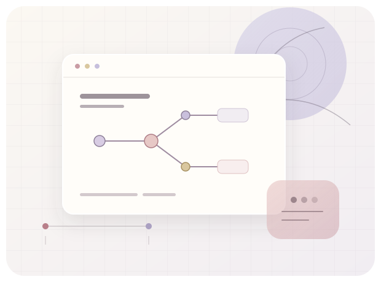

# Hi, I'm Mukti! 👋

<table width="100%" border="0" cellpadding="8" cellspacing="0">
  <tr>
    <td width="62%" valign="middle">
      
I'm pursuing a B.Tech in Computer Science and Engineering at IIIT Naya Raipur. I'm interested in software engineering, backend development, computer vision, artificial intelligence, and machine learning.

      
I enjoy understanding how technology works, experimenting with ideas, solving problems, and learning by building.

    </td>
    <td width="38%" align="center" valign="middle">
      
    </td>
  </tr>
</table>

## Areas of interest

<table width="100%" border="0" cellpadding="14" cellspacing="8">
  <tr>
    <td width="50%" bgcolor="#F8F6F2" valign="middle"> &nbsp; <strong>Software Engineering</strong></td>
    <td width="50%" bgcolor="#F5F2F7" valign="middle"> &nbsp; <strong>Backend Development</strong></td>
  </tr>
  <tr>
    <td width="50%" bgcolor="#F5F2F7" valign="middle"> &nbsp; <strong>Data Structures &amp; Algorithms</strong></td>
    <td width="50%" bgcolor="#F8F6F2" valign="middle"> &nbsp; <strong>Computer Vision</strong></td>
  </tr>
  <tr>
    <td width="50%" bgcolor="#F8F6F2" valign="middle"> &nbsp; <strong>AI &amp; Machine Learning</strong></td>
    <td width="50%" bgcolor="#F5F2F7" valign="middle"> &nbsp; <strong>Open Source</strong></td>
  </tr>
</table>

## Technology stack

<table width="100%" border="0" cellpadding="14" cellspacing="8">
  <tr>
    <td width="50%" bgcolor="#F8F6F2" valign="top">
      <strong>01 / LANGUAGES</strong>  
       &nbsp; Python 
       &nbsp; JavaScript 
       &nbsp; TypeScript 
       &nbsp; R
    </td>
    <td width="50%" bgcolor="#F5F2F7" valign="top">
      <strong>02 / DEVELOPMENT</strong>  
       &nbsp; Astro 
       &nbsp; React 
       &nbsp; Node.js 
       &nbsp; Three.js 
       &nbsp; Tailwind CSS
    </td>
  </tr>
  <tr>
    <td width="50%" bgcolor="#F5F2F7" valign="top">
      <strong>03 / AI &amp; DATA</strong>  
       &nbsp; PyTorch 
       &nbsp; OpenCV 
       &nbsp; NumPy 
       &nbsp; WebR
    </td>
    <td width="50%" bgcolor="#F8F6F2" valign="top">
      <strong>04 / TOOLS</strong>  
       &nbsp; Git 
       &nbsp; GitHub 
       &nbsp; Docker 
       &nbsp; Vercel
    </td>
  </tr>
</table>

Selected from the languages, dependencies, and deployment files in my public repositories.

## Find me

<table width="100%" border="0" cellpadding="14" cellspacing="8">
  <tr>
    <td width="50%" bgcolor="#F8F6F2"><a href="https://github.com/mukti786"> &nbsp; <strong>GitHub</strong></a></td>
    <td width="50%" bgcolor="#F5F2F7"><a href="https://www.linkedin.com/in/mukti-pandit"> &nbsp; <strong>LinkedIn</strong></a></td>
  </tr>
  <tr>
    <td width="50%" bgcolor="#F5F2F7"><a href="https://www.youtube.com/@Mukti_Pandit"> &nbsp; <strong>YouTube</strong></a></td>
    <td width="50%" bgcolor="#F8F6F2"><a href="mailto:mukti.pandit.dev@gmail.com"> &nbsp; <strong>Email</strong></a></td>
  </tr>
</table>
