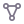

# Hi, I'm Mukti! 👋

I'm pursuing a B.Tech in Computer Science and Engineering at IIIT Naya Raipur. I'm interested in software engineering, backend development, computer vision, artificial intelligence, and machine learning.

I enjoy understanding how technology works, experimenting with ideas, solving problems, and learning by building.

## Areas of interest

  <kbd> &nbsp; Software Engineering</kbd> &nbsp;
  <kbd> &nbsp; Backend Development</kbd> &nbsp;
  <kbd> &nbsp; Data Structures &amp; Algorithms</kbd>  
  <kbd> &nbsp; Computer Vision</kbd> &nbsp;
  <kbd> &nbsp; AI &amp; Machine Learning</kbd> &nbsp;
  <kbd> &nbsp; Open Source</kbd>

## Technology stack

Selected from the languages, dependencies, and deployment files in my public repositories.

### Languages

  &nbsp; Python  
  &nbsp; JavaScript  
  &nbsp; TypeScript  
  &nbsp; R

### Development

  &nbsp; Astro  
  &nbsp; React  
  &nbsp; Node.js  
  &nbsp; Three.js  
  &nbsp; Tailwind CSS

### AI &amp; Data

  &nbsp; PyTorch  
  &nbsp; OpenCV  
  &nbsp; NumPy  
  &nbsp; WebR

### Tools

  &nbsp; Git  
  &nbsp; GitHub  
  &nbsp; Docker  
  &nbsp; Vercel

## Connect

  <a href="https://github.com/mukti786">&nbsp; GitHub</a> &nbsp;&nbsp;
  <a href="https://www.linkedin.com/in/mukti-pandit">&nbsp; LinkedIn</a>  
  <a href="https://www.youtube.com/@Mukti_Pandit">&nbsp; YouTube</a> &nbsp;&nbsp;
  <a href="mailto:mukti.pandit.dev@gmail.com">&nbsp; Email</a>

