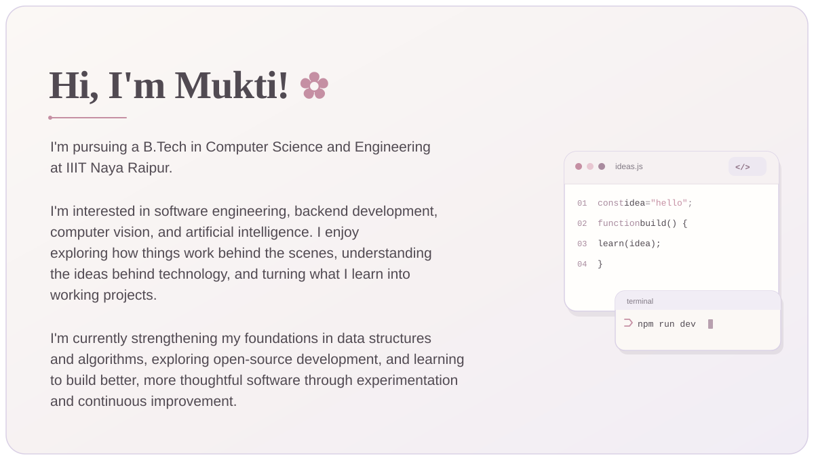

  <picture>
    <source media="(max-width: 560px)" srcset="assets/hero-mobile.svg" />
    
  </picture>

## Areas of interest

<table width="100%" border="0" cellpadding="14" cellspacing="10">
  <tr>
    <td width="50%" bgcolor="#F6F1F2" align="center" valign="middle"> <strong>Software Engineering</strong></td>
    <td width="50%" bgcolor="#F8F5F8" align="center" valign="middle"> <strong>Backend Development</strong></td>
  </tr>
  <tr>
    <td width="50%" bgcolor="#F8F5F8" align="center" valign="middle"> <strong>Data Structures &amp; Algorithms</strong></td>
    <td width="50%" bgcolor="#F6F1F2" align="center" valign="middle"> <strong>Computer Vision</strong></td>
  </tr>
  <tr>
    <td width="50%" bgcolor="#F6F1F2" align="center" valign="middle"> <strong>AI &amp; Machine Learning</strong></td>
    <td width="50%" bgcolor="#F8F5F8" align="center" valign="middle"> <strong>Open Source</strong></td>
  </tr>
</table>

## Technology stack

### Languages

  &nbsp; <strong>Python</strong> &nbsp;&nbsp;
  &nbsp; <strong>JavaScript</strong> &nbsp;&nbsp;
  &nbsp; <strong>TypeScript</strong> &nbsp;&nbsp;
  &nbsp; <strong>R</strong>

### Development

  &nbsp; <strong>Astro</strong> &nbsp;&nbsp;
  &nbsp; <strong>React</strong> &nbsp;&nbsp;
  &nbsp; <strong>Node.js</strong> &nbsp;&nbsp;
  &nbsp; <strong>Three.js</strong> &nbsp;&nbsp;
  &nbsp; <strong>Tailwind CSS</strong>

### AI &amp; Data

  &nbsp; <strong>PyTorch</strong> &nbsp;&nbsp;
  &nbsp; <strong>OpenCV</strong> &nbsp;&nbsp;
  &nbsp; <strong>NumPy</strong> &nbsp;&nbsp;
  &nbsp; <strong>WebR</strong>

### Tools

  &nbsp; <strong>Git</strong> &nbsp;&nbsp;
  &nbsp; <strong>GitHub</strong> &nbsp;&nbsp;
  &nbsp; <strong>Docker</strong> &nbsp;&nbsp;
  &nbsp; <strong>Vercel</strong>

## Connect

<table width="100%" border="0" cellpadding="16" cellspacing="10">
  <tr>
    <td width="50%" bgcolor="#F6F1F2" align="center" valign="middle"><a href="https://github.com/mukti786" title="GitHub profile"> <strong>GitHub</strong></a></td>
    <td width="50%" bgcolor="#F8F5F8" align="center" valign="middle"><a href="https://www.linkedin.com/in/mukti-pandit" title="LinkedIn profile"> <strong>LinkedIn</strong></a></td>
  </tr>
  <tr>
    <td width="50%" bgcolor="#F8F5F8" align="center" valign="middle"><a href="https://www.youtube.com/@Mukti_Pandit" title="YouTube channel"> <strong>YouTube</strong></a></td>
    <td width="50%" bgcolor="#F6F1F2" align="center" valign="middle"><a href="mailto:mukti.pandit.dev@gmail.com" title="Email Mukti"> <strong>Email</strong></a></td>
  </tr>
</table>
